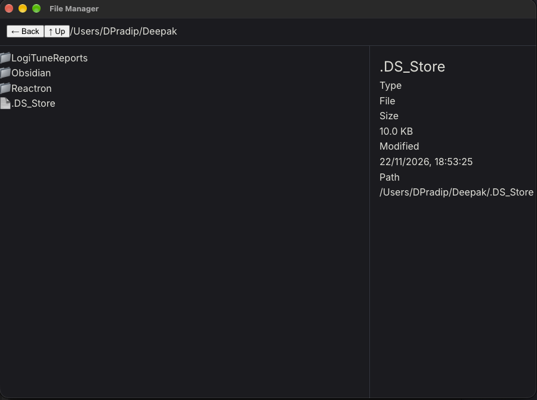

# File Manager

A small desktop file manager built with Electron and React. It browses the local file system, shows folder contents, and opens files with their default application.




## Features

**MVP (implemented)**

- Starts in the user's home folder.
- Lists folders first, then files, sorted alphabetically.
- Double-click a folder to open it.
- **Up** button to go to the parent folder.
- **Back** button with navigation history.
- Click a file to see its details: name, type, size, last modified, and full path.
- Double-click a file to open it in the operating system's default application.
- Loading, error, and empty-folder states.

**Not implemented (out of scope for this build)**

- Search / filter
- Sorting by name, size, or date
- Create folder
- Show/hide hidden files toggle (hidden files are currently always shown)
- Delete, rename, drag-and-drop, multiple tabs
- Multi-select

## Tech stack

| Layer         | Technology                                            |
| ------------- | ----------------------------------------------------- |
| Desktop shell | Electron 44                                           |
| Main process  | Node.js `fs/promises`, `path`, `os`, `electron.shell` |
| Secure bridge | Preload script + `contextBridge`                      |
| UI            | React 19 + Vite 8                                     |
| Build tooling | electron-vite 6, electron-builder 26                  |
| Code quality  | ESLint 9, Prettier 3                                  |

## Getting started

### Prerequisites

- Node.js 20 or newer
- npm

The app has been developed and tested on macOS (Apple Silicon). It should work on Windows and Linux, but those targets have not been tested.

### Install

```bash
npm install
```

### Development

```bash
npm run dev
```

This starts electron-vite, opens the app window, and enables hot reload for the renderer.

### Other scripts

| Command                | Description                                     |
| ---------------------- | ----------------------------------------------- |
| `npm run dev`          | Run the app in development with HMR             |
| `npm run lint`         | Run ESLint                                      |
| `npm run format`       | Format all files with Prettier                  |
| `npm run build`        | Compile main, preload, and renderer into `out/` |
| `npm run start`        | Preview the compiled app from `out/`            |
| `npm run build:unpack` | Package an unpacked app into `dist/`            |
| `npm run build:mac`    | Build a macOS installer (`.dmg`)                |
| `npm run build:win`    | Build a Windows installer                       |
| `npm run build:linux`  | Build Linux packages (AppImage, snap, deb)      |

## Project structure

```text
file-manager/
├── src/
│   ├── main/
│   │   └── index.js          # Electron main process + IPC handlers
│   ├── preload/
│   │   └── index.js          # Safe bridge exposed through contextBridge
│   └── renderer/
│       ├── index.html
│       └── src/
│           ├── App.jsx       # State, data loading, navigation
│           ├── main.jsx      # React entry point
│           ├── components/
│           │   ├── Toolbar.jsx
│           │   ├── FileList.jsx
│           │   ├── FileItem.jsx
│           │   └── DetailsPanel.jsx
│           ├── utils/
│           │   └── format.js # File size and date formatting
│           └── assets/       # Global CSS and icons
├── build/                    # App icons and macOS entitlements
├── docs/
│   ├── architecture.md
│   ├── learnings.md
│   └── screenshots/
├── electron-builder.yml      # Packaging configuration
├── electron.vite.config.mjs  # electron-vite configuration
└── package.json
```

## How it works

The renderer never touches the file system. It asks the preload bridge, which sends an IPC message to the main process. The main process reads the folder with Node's async `fs` API and returns plain data that React can render.

The full walkthrough — including the IPC table, the data shape, and what happens on a double-click — is in [`docs/architecture.md`](docs/architecture.md).

## Security decisions

- **Context isolation stays on** (Electron's default) and **Node integration stays off**, so renderer code cannot access Node or Electron internals directly.
- The preload exposes **only three named functions** (`getHomeDir`, `readDir`, `openPath`) instead of exposing `ipcRenderer` itself.
- The main process **validates input** before using a path: it must be a string and an absolute path.
- File system access uses **async `fs/promises`**, so the UI never freezes on slow folders.
- The `remote` module is not used; all communication goes through `ipcMain.handle` / `ipcRenderer.invoke`.
- `sandbox: false` is kept from the electron-vite template so the preload bundle can use Node imports. This is a known trade-off and a candidate for future hardening.

## Packaging

```bash
# Quick local test: unpacked app in dist/mac-arm64/FileManager.app
npm run build:unpack

# macOS installer
npm run build:mac
```

Builds are currently **unsigned** and **not notarized**. Locally built apps run fine; a shared build may trigger macOS Gatekeeper and need a right-click → **Open** (or removal of the quarantine flag). Distribution would require an Apple Developer ID certificate and notarization.

## Known limitations

- No search, filter, sort, or hidden-file toggle.
- No delete, rename, drag-and-drop, or tabs.
- Large folders are read with one `fs.stat` per entry and rendered without virtualization, so very large directories may feel slow.
- Symlinked directories are followed for navigation, but symlink loops are not specially handled.
- Permission errors are shown as an error message; there is no retry button.
- No automated tests yet.
- Only macOS has been tested.
- The packaged app is unsigned.

## Next steps

- Search/filter in the current folder.
- Sort by name, size, or date.
- Create folder.
- Keyboard navigation and shortcuts.
- "Reveal in Finder" using `shell.showItemInFolder`.
- Virtualized file list for huge folders.
- Automated tests for the main-process handlers and React components.
- CI builds for macOS, Windows, and Linux, with code signing and notarization.

## Documentation

- [`docs/architecture.md`](docs/architecture.md) — process model, IPC channels, and request walkthroughs.
- [`docs/learnings.md`](docs/learnings.md) — what was learned, bugs hit, and open questions.
- [`docs/screenshots/`](docs/screenshots/) — screenshots used in this README and the demo.
