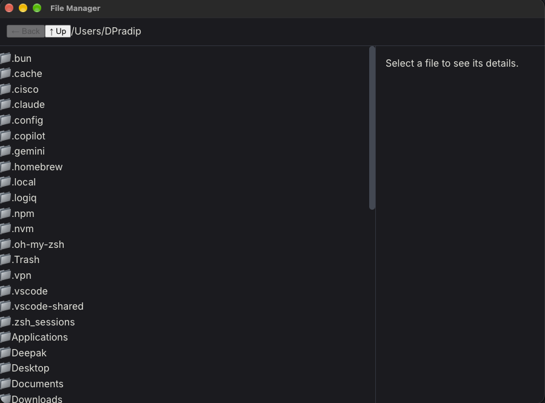

# File Manager

A small desktop file manager built with Electron and React. It browses the local file system, shows folder contents, and opens files with their default application.

### Main window



### Navigation along with file details


## Features

**MVP (implemented)**

- Starts in the user's home folder.
- Lists folders first, then files, sorted alphabetically.
- Double-click a folder to open it.
- **Up** button to go to the parent folder.
- **Back** button with navigation history.
- Click a file to see its details: name, type, size, last modified, and full path.
- Double-click a file to open it in the operating system's default application.
- File-type icons, hover, selected, and keyboard focus states.
- Show/hide hidden files (dot-prefixed names) with a toolbar toggle.
- Switch between the default palette and Catppuccin; the OS still decides light or dark (Latte / Mocha).
- In the default palette, file selection and focus colours follow the macOS accent color live.
- Right-click a file or folder for a native menu with Open, Reveal in file manager, and Copy path; the details panel also has a Reveal button.
- Clickable breadcrumb path; click any ancestor segment to jump back to it.
- Loading, error, and empty-folder states.

**Not implemented (out of scope for this build)**

- Search / filter
- Sorting by name, size, or date
- Create folder
- Delete, rename, drag-and-drop, multiple tabs
- Multi-select

## Tech stack

| Layer         | Technology                                            |
| ------------- | ----------------------------------------------------- |
| Language      | TypeScript 5.9 (strict), ES modules                   |
| Desktop shell | Electron 44                                           |
| Main process  | Node.js `fs/promises`, `path`, `os`, `electron.shell` |
| Secure bridge | Preload script + `contextBridge`                      |
| UI            | React 19 + Vite 8                                     |
| Styling       | SCSS (Sass) with BEM and CSS custom properties        |
| Icons         | lucide-react                                          |
| Build tooling | electron-vite 6, electron-builder 26                  |
| Code quality  | ESLint 9 (+ `typescript-eslint`), Prettier 3          |

## Getting started

### Prerequisites

- Node.js 20 or newer
- npm

The app has been developed and tested on macOS (Apple Silicon). It should work on Windows and Linux, but those targets have not been tested.

### Install

```bash
npm install
```

### Development

```bash
npm run dev
```

This starts electron-vite, opens the app window, and enables hot reload for the renderer.

### Other scripts

| Command                  | Description                                     |
| ------------------------ | ----------------------------------------------- |
| `npm run dev`            | Run the app in development with HMR             |
| `npm run lint`           | Run ESLint (including TypeScript rules)         |
| `npm run typecheck`      | Type-check main/preload **and** the renderer    |
| `npm run typecheck:node` | Type-check only `src/main` + `src/preload`      |
| `npm run typecheck:web`  | Type-check only the React renderer              |
| `npm run format`         | Format all files with Prettier                  |
| `npm run build`          | Compile main, preload, and renderer into `out/` |
| `npm run start`          | Preview the compiled app from `out/`            |
| `npm run build:unpack`   | Package an unpacked app into `dist/`            |
| `npm run build:mac`      | Build a macOS installer (`.dmg`)                |
| `npm run build:win`      | Build a Windows installer                       |
| `npm run build:linux`    | Build Linux packages (AppImage, snap, deb)      |

## Project structure

```text
file-manager/
├── src/
│   ├── main/
│   │   └── index.ts          # Electron main process + IPC handlers
│   ├── preload/
│   │   ├── index.ts          # Safe bridge exposed through contextBridge
│   │   └── index.d.ts        # Declares window.fileApi for the renderer
│   ├── shared/
│   │   └── types.ts          # FileEntry / DirResult shared by all three processes
│   └── renderer/
│       ├── index.html
│       └── src/
│           ├── App.tsx       # State, data loading, navigation
│           ├── main.tsx      # React entry point
│           ├── env.d.ts      # Vite client types
│           ├── components/
│           │   ├── Toolbar.tsx
│           │   ├── FileList.tsx
│           │   ├── FileItem.tsx
│           │   └── DetailsPanel.tsx
│           ├── utils/
│           │   ├── format.ts    # File size and date formatting
│           │   └── fileIcons.ts # Extension → lucide icon mapping
│           └── styles/
│               ├── main.scss    # The only stylesheet React imports
│               ├── abstracts/   # Variables, functions, mixins
│               ├── base/        # Reset, theme tokens, typography
│               ├── layout/      # App shell grid
│               └── components/  # Toolbar, list, item, details, states
├── build/                    # App icons and macOS entitlements
├── docs/
│   ├── architecture.md
│   ├── learnings.md
│   └── screenshots/
├── electron-builder.yml      # Packaging configuration
├── electron.vite.config.mjs  # electron-vite configuration
├── tsconfig.json             # Solution file referencing the two projects below
├── tsconfig.node.json        # Main + preload + vite config (Node types)
├── tsconfig.web.json         # Renderer (DOM types, react-jsx)
└── package.json
```

## How it works

The renderer never touches the file system. It asks the preload bridge, which sends an IPC message to the main process. The main process reads the folder with Node's async `fs` API and returns plain data that React can render.

The full walkthrough — including the IPC table, the data shape, and what happens on a double-click — is in [`docs/architecture.md`](docs/architecture.md).

## TypeScript setup

All source files are TypeScript (`.ts` / `.tsx`). electron-vite transpiles them automatically; no build configuration was needed for the migration. Type checking is a separate step:

```bash
npm run typecheck
```

| File                        | Role                                                                                                         |
| --------------------------- | ------------------------------------------------------------------------------------------------------------ |
| `tsconfig.node.json`        | Main + preload + `electron.vite.config.mjs`; includes Node globals and electron-vite's `?asset` module types |
| `tsconfig.web.json`         | Renderer; DOM types, `react-jsx`, and the `@renderer/*` path alias to `src/renderer/src`                     |
| `tsconfig.json`             | Solution file referencing both projects so editors can use them together                                     |
| `src/shared/types.ts`       | `FileEntry`, `DirResult`, and `ThemeFamily`, imported by the main process, preload, and renderer             |
| `src/preload/index.d.ts`    | Declares the three functions on `window.fileApi` for the renderer                                            |
| `src/renderer/src/env.d.ts` | Vite client types                                                                                            |

Two details are worth knowing:

- **`npm run build` does not type-check.** It transpiles with esbuild. Run `npm run typecheck` before shipping.
- **`noImplicitAny` is explicitly enabled** in both project configs. The shared `@electron-toolkit/tsconfig` base turns it off, so it has to be set per project. IPC arguments are typed `unknown` and narrowed by the `typeof` / `path.isAbsolute` checks.

`react/prop-types` is deliberately off: TypeScript's prop interfaces replace runtime PropTypes entirely.

## Styling

The template CSS has been replaced by an SCSS structure under `src/renderer/src/styles/`. React imports a single entry point, `styles/main.scss`, which pulls in the rest with `@use`.

- **BEM class names** — `file-item`, `file-item--selected`, `details-panel__name`.
- **Sass for compile-time values** — the spacing scale, radii, and layout sizes (`space(3)`, `$toolbar-height`).
- **CSS custom properties for colors** — they survive the build and switch under `@media (prefers-color-scheme: dark)`.
- **Two theme families** — the toolbar toggle writes `data-theme-family` on `<html>` and persists it in `localStorage`; within each family the OS still decides light vs dark. Catppuccin uses Latte for light and Mocha for dark.
- **System accent** — in the default family only, a `--accent-source` custom property is mapped onto `--color-accent` and `--color-selected`. Text selection (`::selection`) is left to macOS.
- **CSS Grid layout** — toolbar across the top, file list on the left, details panel on the right, each scrolling independently.

The full conventions and folder guide are in [`docs/styling.md`](docs/styling.md).

## Security decisions

- **Context isolation stays on** (Electron's default) and **Node integration stays off**, so renderer code cannot access Node or Electron internals directly.
- The preload exposes **seven named functions** (`getHomeDir`, `readDir`, `openPath`, `getAccentColor`, `onAccentColorChanged`, `showItemInFolder`, `showContextMenu`) instead of exposing `ipcRenderer` itself. The native context menu is built in main, so `shell` and `clipboard` stay out of the renderer. All signatures are declared in `src/preload/index.d.ts`.
- Both IPC handlers **validate input** before using a path: the argument is typed `unknown`, then narrowed to a string and checked with `path.isAbsolute`. `fs:readDir` rejects with `Invalid folder path`, `shell:openPath` with `Invalid file path`.
- File system access uses **async `fs/promises`**, so the UI never freezes on slow folders.
- The `remote` module is not used; all communication goes through `ipcMain.handle` / `ipcRenderer.invoke`.
- `sandbox: false` is kept from the electron-vite template so the preload bundle can use Node imports. This is a known trade-off and a candidate for future hardening.

## Packaging

```bash
# Quick local test: unpacked app in dist/mac-arm64/FileManager.app
npm run build:unpack

# macOS installer
npm run build:mac
```

Builds are currently **unsigned** and **not notarized**. Locally built apps run fine; a shared build may trigger macOS Gatekeeper and need a right-click → **Open** (or removal of the quarantine flag). Distribution would require an Apple Developer ID certificate and notarization.

## Known limitations

- No search, filter, or sort.
- Hidden-file filtering is dot-prefix based (the POSIX definition), so Windows hidden attributes are not detected.
- No delete, rename, drag-and-drop, or tabs.
- Large folders are read with one `fs.stat` per entry and rendered without virtualization, so very large directories may feel slow.
- Symlinked directories are followed for navigation, but symlink loops are not specially handled.
- Permission errors are shown as an error message; there is no retry button.
- No automated tests yet.
- Type errors are only reported by `npm run typecheck`, not by `npm run build`.
- Only macOS has been tested.
- In development the macOS Dock tooltip says **Electron**; the packaged app shows **FileManager**. `app.setName()` changes Electron's internal name but not the OS-supplied Dock label, which comes from `Electron.app`'s `Info.plist` in dev.
- The packaged app is unsigned.

## Next steps

- Search/filter in the current folder.
- Sort by name, size, or date, plus a Name / Size / Modified header row.
- Create folder.
- Keyboard navigation and shortcuts.
- Virtualized file list for huge folders.
- Automated tests for the main-process handlers and React components.
- Add `typecheck` and `lint` to a CI pipeline.
- CI builds for macOS, Windows, and Linux, with code signing and notarization.

## Documentation

- [`docs/architecture.md`](docs/architecture.md) — process model, IPC channels, and request walkthroughs.
- [`docs/styling.md`](docs/styling.md) — SCSS structure, design tokens, theming, and conventions.
- [`docs/learnings.md`](docs/learnings.md) — what was learned, bugs hit, and open questions.
- [`docs/screenshots/`](docs/screenshots/) — screenshots used in this README and the demo
