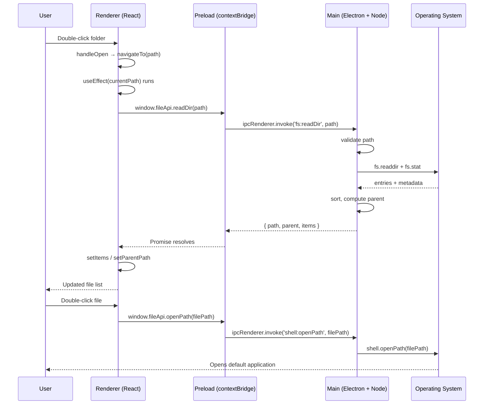

# Architecture

This document explains how the app is split across Electron's processes, what each process is allowed to do, and how a user action travels from React to the file system and back.

## The three processes

| Process      | File                   | Responsibility                                                                  | Can access the file system?                  |
| ------------ | ---------------------- | ------------------------------------------------------------------------------- | -------------------------------------------- |
| **Main**     | `src/main/index.js`    | Creates windows, owns the app lifecycle, reads folders, opens files with the OS | Yes, through Node                            |
| **Preload**  | `src/preload/index.js` | Runs before the page loads and exposes a small, explicit API to the renderer    | No direct file access; it forwards IPC calls |
| **Renderer** | `src/renderer/src/**`  | React UI: state, rendering, clicks, and navigation                              | No — it only calls `window.fileApi`          |

The key rule: **the renderer never touches `fs` or `path`.** Everything that needs the operating system goes through the preload bridge to the main process.

## Process responsibilities

### Main process

`src/main/index.js` does three jobs:

1. **App lifecycle** — `app.whenReady()`, window creation, macOS `activate`, and `window-all-closed`.
2. **File system access** — the `fs:readDir` handler reads a folder and returns plain JSON-safe data.
3. **Shell integration** — `shell:openPath` hands a file to the operating system, which opens it with the default application for that file type.

It also keeps the existing electron-vite behaviour: load the dev server URL in development, or the built `index.html` in production.

### Preload

`src/preload/index.js` exposes exactly three functions:

```js
contextBridge.exposeInMainWorld('fileApi', {
  getHomeDir: () => ipcRenderer.invoke('fs:getHomeDir'),
  readDir: (dirPath) => ipcRenderer.invoke('fs:readDir', dirPath),
  openPath: (filePath) => ipcRenderer.invoke('shell:openPath', filePath)
})
```

It never exposes `ipcRenderer` itself. The renderer can only call these three operations — it cannot invent new IPC channels or reach Node APIs.

### Renderer

The renderer is a normal React app:

- `App.jsx` owns all application state and the data-loading effect.
- `Toolbar`, `FileList`, `FileItem`, and `DetailsPanel` are presentational components that receive props and report events.
- `utils/format.js` contains pure formatting helpers.

## IPC channels

| Channel          | Direction       | Input                | Returns                      |
| ---------------- | --------------- | -------------------- | ---------------------------- |
| `fs:getHomeDir`  | Renderer → Main | none                 | The user's home folder path  |
| `fs:readDir`     | Renderer → Main | Absolute folder path | `{ path, parent, items }`    |
| `shell:openPath` | Renderer → Main | File path            | Nothing, or an error message |

`fs:readDir` rejects with `Invalid folder path` if the argument is not a string or is not absolute. `shell:openPath` rejects if the OS returns an error message (for example, no application is associated with the file).

## The item data shape

Each entry returned by `fs:readDir` looks like this:

| Field         | Type    | Example                           | Notes                                                |
| ------------- | ------- | --------------------------------- | ---------------------------------------------------- |
| `name`        | string  | `"report.pdf"`                    | Base name only                                       |
| `path`        | string  | `/Users/you/Documents/report.pdf` | Absolute path                                        |
| `isDirectory` | boolean | `false`                           | Uses `stats.isDirectory()`, so symlinks are followed |
| `size`        | number  | `48213`                           | Bytes; not meaningful for directories                |
| `modified`    | number  | `1732300000000`                   | `stats.mtimeMs`, milliseconds since epoch            |
| `extension`   | string  | `".pdf"`                          | Lowercased; empty string when there is no extension  |

Entries are sorted with **folders first**, then by name using `localeCompare`. Entries whose `fs.stat` fails are skipped instead of failing the whole folder.

## Walkthrough: double-clicking a folder

1. `FileItem` fires `onDoubleClick` and calls `onOpen(item)`.
2. `App.handleOpen(item)` sees `item.isDirectory === true` and calls `navigateTo(item.path)`.
3. `navigateTo` pushes the current path onto `history` and sets `currentPath` to the new folder.
4. The `useEffect` that depends on `currentPath` runs. It marks the request as not cancelled, sets `loading`, clears the previous error and selection, and calls `window.fileApi.readDir(currentPath)`.
5. The preload calls `ipcRenderer.invoke('fs:readDir', currentPath)`.
6. The main process validates the path, runs `fs.readdir(..., { withFileTypes: true })`, calls `fs.stat` for each entry, sorts the results, computes the parent path, and returns `{ path, parent, items }`.
7. Back in React, `setItems(result.items)` and `setParentPath(result.parent)` update the UI, and `loading` becomes `false`.
8. `FileList` re-renders the new items. `DetailsPanel` receives `null` and shows its empty state.

If the user navigates again before the first request finishes, the cleanup function sets `cancelled = true`, so the stale response is ignored. This prevents an older, slower folder from overwriting a newer one.

## Walkthrough: double-clicking a file

1. `FileItem` calls `onOpen(item)`.
2. `App.handleOpen` sees `item.isDirectory === false` and calls `window.fileApi.openPath(item.path)`.
3. The preload invokes `shell:openPath` in the main process.
4. The main process calls `shell.openPath(filePath)`.
5. Electron asks the operating system to open the path "in the desktop's default manner" — the same behaviour as double-clicking the file in Finder/Explorer. The OS picks the application registered for that file type (for example, Word for `.docx`).
6. If the OS returns an error message, the main process throws it and `App` shows the message in the error state.

`shell.openPath` does **not** mean "open Finder". Finder is a file manager, not the default handler for files. To reveal a file in the file manager instead, Electron provides `shell.showItemInFolder`.

## Diagram



## State ownership

All state lives in `App.jsx`:

| State         | Purpose                                               |
| ------------- | ----------------------------------------------------- |
| `currentPath` | Folder currently displayed                            |
| `parentPath`  | Parent folder, or `null` at the file-system root      |
| `history`     | Array of previously visited paths for the Back button |
| `items`       | Entries in the current folder                         |
| `selected`    | The selected item object, or `null`                   |
| `loading`     | Whether a folder request is in flight                 |
| `error`       | Error message to display                              |

Child components are intentionally stateless. This keeps the data flow one-directional and makes it obvious where a bug lives: if the UI is wrong, check the props `App` passed down.

## Error handling

- **Invalid IPC input** is rejected in the main process, not trusted from the UI.
- **Unreadable entries** are skipped during `readDir` instead of failing the folder.
- **Folder read failures** (for example, permission denied) reject the promise and appear in the error state.
- **File open failures** (no associated app, missing file) are caught in `App` and shown as an error message.
- **Stale requests** are ignored through the `cancelled` flag in the effect cleanup.
